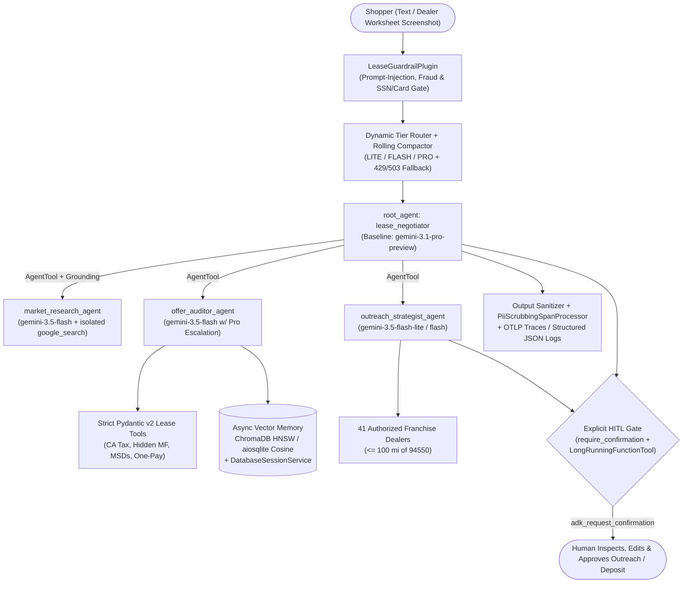

# LeaseNegotiator — Production Multi-Agent Car Lease Negotiation Platform (Google ADK + Gemini)

[](#ci--evaluation)
[](https://www.python.org/)
[](https://google.github.io/adk-docs/)
[](#observability-tracing--pii-redaction)
[](LICENSE)

**LeaseNegotiator** (`v0.2.0`) is a production-grade multi-agent car lease negotiation system built with **Google Agent Development Kit (`google-adk>=2.0.0`)**, **Gemini tiered model routing**, **strict Pydantic v2 tool contracts**, **asynchronous vector memory + rolling history compaction**, **ADK safety/financial guardrails**, **explicit Human-in-the-Loop (HITL) execution gates**, and **OpenTelemetry distributed tracing with multi-layer PII redaction**.

Out of the box, it serves shoppers within **100 miles of ZIP `94550` (Livermore, CA — 10.25% sales tax, California $85 statutory doc-fee cap)** across four 3-row EVs and plug-in hybrids (and is fully configurable via `.env`):

- **Hyundai IONIQ 9** *(Hyundai Motor Finance — HMF)*
- **Kia EV9** *(Kia Finance America — KFA)*
- **Volvo EX90** *(Volvo Car Financial Services — VCFS, up to 10 refundable MSDs + A-Plan)*
- **Volvo XC90 Plug-In Hybrid (T8)** *(VCFS, refundable MSDs + PHEV Lease Allowances)*

---

## Architecture Overview



---

## Key Engineering Capabilities

### 1. Strict Pydantic v2 Tool Contracts & Guided Self-Recovery (`schemas.py`, `tools/`)
- Every client tool validates inputs (`LeaseCalculationRequest`) and returns **frozen, strict Pydantic v2 models** (`ConfigDict(extra="forbid", frozen=True, validate_default=True)`): `AprMoneyFactorResult`, `LeasePaymentResult`, `DealerQuoteAuditResult`, `TargetCounterofferResult`, `LeaseOfferComparisonResult`, `VehicleProfileResult`, `TargetModelsOverviewResult`, `DealershipDirectoryResult`, `SaveOfferMemoryResult`, `SearchDealMemoryResult`, `SessionCompactionSummary`, and `OutreachApprovalResult`.
- Out-of-range inputs never crash the agent loop: tools return `ToolErrorGuidance` with `error_code`, `invalid_fields`, and a concrete `recovery_hint` paired with ADK's `ReflectAndRetryToolPlugin`.

### 2. Rolling History Compaction & Async Persistent Vector Memory (`memory/`)
- **Dual-Layer Context Compaction (`memory/compaction.py`)**: Combines ADK's native `EventsCompactionConfig` + `ContextFilterPlugin` with a lease-domain-aware async `HistoryCompactionManager` that distills older negotiation turns into compact financial anchors (preserving exact `$` prices, Money Factors, Residual percentages, and VIN/Stock IDs while safely keeping `function_call`/`function_response` pairs intact).
- **Persistent Session & Vector Store (`memory/vector_store.py`, `memory/session_factory.py`)**: Persists ADK sessions via `DatabaseSessionService` (`sqlite+aiosqlite` or Postgres) and embeds audited dealer worksheets asynchronously into **ChromaDB** (`PersistentClient` cosine HNSW) or a zero-dependency **async SQLite cosine similarity vector store** (`AsyncDealVectorMemoryStore` with Gemini `embed_content` + deterministic 256-d L2-normalized feature-hash fallback).
- **Non-Blocking Async Memory Tools (`tools/memory_tools.py`)**: `async def save_dealer_offer_to_memory`, `async def search_past_offers_semantic`, and `async def compact_negotiation_notes` synchronize ADK `user:` and session-scoped state keys cleanly.

### 3. Strategic Multi-Model Routing, ADK Guardrails & HITL (`orchestration/`)
- **Multi-Model Tier Routing (`orchestration/model_router.py`)**:
  - **Coordinator (`PRO`)**: `gemini-3.1-pro-preview` for multimodal worksheet extraction, multi-dealer game theory, and synthesis.
  - **Market Research & Offer Auditor (`FLASH` / `PRO`)**: `gemini-3.5-flash` for low-latency live Google Search grounding and deterministic quote audits (escalating complex multi-offer turns to `PRO`).
  - **Outreach Copywriter (`LITE` / `FLASH`)**: `gemini-3.5-flash-lite` baseline for fast, cost-efficient email/SMS drafting and single-step catalog lookups.
  - **429/503 Capacity Resiliency**: Configures `HttpRetryOptions` exponential backoff (`[408, 429, 500, 502, 503, 504]`) plus an `on_model_error_callback` tier-fallback chain (`PRO -> FLASH -> LITE`) so transient capacity spikes degrade gracefully.
- **Agentic Guardrails (`orchestration/guardrails.py`)**: App-wide ADK `BasePlugin` (`LeaseGuardrailPlugin`) inspecting user prompts (blocking prompt-injection overrides, auto-finance fraud, and raw SSNs/credit card numbers before they hit the LLM), enforcing per-turn tool budgets and passenger-vehicle price bounds (`$1–$500k`), scrubbing tool responses, and neutralizing binding-contract claims or outdated pre-Sept-2025 federal 45W EV tax credit claims on output.
- **Explicit Human-in-the-Loop Execution Hooks (`orchestration/hitl.py`)**: Combines ADK `App(..., resumability_config=ResumabilityConfig(is_resumable=True))`, `FunctionTool(..., require_confirmation=should_require_human_approval)`, `tool_context.request_confirmation(...)`, and `LongRunningFunctionTool(func=request_human_counteroffer_review)` so dealer outreach dispatch, deposit holds, and offers exceeding `HITL_MAX_EFFECTIVE_MONTHLY_USD` pause deterministically until a human approves or rejects.

### 4. Observability, OpenTelemetry Tracing & PII Redaction (`observability/`)
- **Multi-Layer PII Redaction (`observability/pii_redactor.py`)**: Scrubs SSNs, Luhn-validated payment cards (while preserving 17-character automobile VINs and lease prices), API keys/Bearer tokens, emails, phone numbers, and sensitive dictionary keys across logs, trace attributes, and vector storage.
- **Structured JSON Logging (`observability/logging_config.py`)**: Emits single-line JSON logs enriched with `ContextVar` `correlation_id`, `session_id`, `agent_name`, `model_tier`, and active OpenTelemetry W3C `trace_id`/`span_id`.
- **Distributed Tracing & Metrics (`observability/telemetry.py`)**: Configures OpenTelemetry `TracerProvider` (OTLP HTTP exporter to Jaeger / Cloud Trace, console, or in-memory test exporter), `PiiScrubbingSpanProcessor`, `MeterProvider` counters/histograms (`model_calls`, `tool_calls`, `guardrail_interventions`, `hitl_pauses`, `http_duration_ms`), `@traced_tool` sync/async instrumentation, and ADK `LeaseObservabilityPlugin` + `AutoTracingPlugin`.

---

## Repository Structure

```text
LeaseNegotiator/
├── lease_negotiator/
│   ├── __init__.py
│   ├── agent.py                     # Root ADK `app` + `root_agent` entrypoint
│   ├── server.py                    # Production FastAPI server (/healthz, /readyz, DB session lifespan)
│   ├── config.py                    # Typed immutable ShopperConfig (.env loader)
│   ├── schemas.py                   # Strict Pydantic v2 input/output models (extra="forbid", frozen=True)
│   ├── prompts.py                   # Persona, guardrail, memory & HITL system instructions
│   ├── data/
│   │   ├── models_catalog.py        # IONIQ 9, EV9, EX90, XC90 PHEV trims & captive rules
│   │   └── dealerships_94550.py     # 41 authorized dealers <= 100 mi of Livermore 94550
│   ├── memory/
│   │   ├── compaction.py            # Rolling history compactor + ADK EventsCompactionConfig/ContextFilterPlugin
│   │   ├── session_factory.py       # Persistent DatabaseSessionService + Runner factory
│   │   └── vector_store.py          # Async ChromaDB HNSW / aiosqlite cosine deal vector store
│   ├── observability/
│   │   ├── pii_redactor.py          # SSN, Luhn card, API token, email/phone redactor & LogFilter
│   │   ├── logging_config.py        # Structured JSON formatter with OTel trace/span correlation
│   │   └── telemetry.py             # OpenTelemetry TracerProvider, MeterProvider, @traced_tool & ADK plugin
│   ├── orchestration/
│   │   ├── model_router.py          # LITE/FLASH/PRO complexity router, HttpRetryOptions & 429/503 fallback
│   │   ├── guardrails.py            # Input/tool/output LeaseGuardrailPlugin + ReflectAndRetryToolPlugin
│   │   └── hitl.py                  # ADK require_confirmation FunctionTool + LongRunningFunctionTool gates
│   ├── sub_agents/
│   │   ├── market_researcher.py     # Flash + isolated Google Search grounding AgentTool
│   │   ├── offer_auditor.py         # Flash/Pro auditor + async vector memory AgentTool
│   │   └── negotiation_drafter.py   # Lite/Flash regional outreach + HITL gates AgentTool
│   └── tools/
│       ├── lease_calculator.py      # CA periodic/upfront tax, MSDs, One-Pay, APR <-> MF (Pydantic)
│       ├── offer_auditor.py         # Hidden-MF back-solver, fee/add-on auditor & comparator (Pydantic)
│       ├── dealership_tools.py      # Vehicle profile & 100-mi dealer directory tools (Pydantic)
│       └── memory_tools.py          # Async vector upsert, semantic recall & note compaction tools
├── tests/                           # Deterministic unit & async tests (>=80% coverage gate)
├── evals/                           # Google ADK trajectory & response regression dataset
├── deploy/cloudrun-service.yaml     # Declarative Cloud Run manifest w/ Secret Manager & health probes
├── Dockerfile                       # Multi-stage non-root (UID 10001) container w/ HEALTHCHECK
├── docker-compose.yml               # Local stack: LeaseNegotiator API/Web + Jaeger OTLP Tracing UI
├── Makefile                         # Developer shortcuts (lint, typecheck, security, test, eval, docker)
└── .github/workflows/               # Multi-job CI (Ruff, Mypy, Bandit, pip-audit, Pytest 3.11-3.13, Docker) + Eval
```

---

## Quick Start

### 1. Local Installation

```bash
python3 -m venv .venv
source .venv/bin/activate
pip install -e ".[dev,db,vector]"

cp lease_negotiator/.env.example lease_negotiator/.env
# Add your GOOGLE_API_KEY from https://aistudio.google.com/apikey to lease_negotiator/.env
```

### 2. Run Interactively (ADK Web UI, CLI, or Production FastAPI Server)

```bash
# Option A: Interactive browser UI (upload dealer quote photos, inspect OTel events & approve HITL prompts)
adk web

# Option B: Interactive terminal session
adk run lease_negotiator

# Option C: Production FastAPI server with persistent SQLite session & vector stores + /healthz /readyz
lease-negotiator-server
```

### 3. Run Full Stack with Distributed Tracing (Docker Compose + Jaeger)

```bash
GOOGLE_API_KEY="your_key" docker compose up --build
```
- **LeaseNegotiator Web & API**: `http://localhost:8080` (`GET /healthz`, `GET /readyz`)
- **Jaeger OpenTelemetry Trace Explorer**: `http://localhost:16686`

---

## CI & Evaluation

```bash
make lint        # ruff check + format verification
make typecheck   # strict mypy (disallow_untyped_defs = true)
make security    # bandit SAST + pip-audit CVE check
make test        # pytest (sync + async) with >=80% coverage enforcement
make eval        # Google ADK trajectory & rubric evaluation suite
```

---

## License

Released under the [MIT License](LICENSE).
